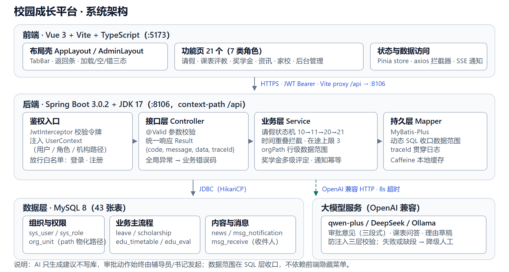

# 02 · 总体技术方案

## 1. 架构总览



分层职责：

| 层 | 职责 | 关键实现 |
|---|---|---|
| 接入 | 静态资源与 `/api` 反向代理、Gzip、限流 | 开发态由 Vite proxy 承担，生产用 Nginx |
| 鉴权 | 令牌校验、注入当前用户 | `JwtInterceptor` → `UserContext`（用户 / 角色 / 机构路径） |
| 接口 | 参数校验、统一响应、异常归一 | `@Valid`、`Result{code,message,data,traceId}` |
| 业务 | 状态机、时间冲突、数据范围、通知 | `LeaveService`、`ScholarshipService`、`MessageService` |
| 持久 | 表读写、动态 SQL，数据范围在 SQL 层收口 | MyBatis-Plus |
| 外部 | 大模型能力（可关闭） | OpenAI 兼容接口，8s 超时，失败降级人工 |

## 2. 技术栈

| 层 | 选型 | 版本 | 说明 |
|---|---|---|---|
| 前端框架 | Vue 3 | 3.4+ | Composition API + `<script setup>` |
| 构建 | Vite | 5+ | 开发态代理解决跨域 |
| 语言 | TypeScript | 5+ | 接口类型由 OpenAPI 生成 |
| 状态 | Pinia | 2+ | user / permission / app 三个 store |
| 路由 | Vue Router | 4+ | 动态路由 + 权限守卫 |
| UI | Tailwind CSS 3 + Element Plus | — | C 端用 Tailwind 自绘，后台用 Element Plus |
| 请求 | Axios | 1.x | 拦截器统一处理 token / code / 重试 |
| 富文本 | @wangeditor/editor | 5 | 新闻/赛事正文 |
| 图表 | ECharts | 5 | 后台统计 |
| 后端框架 | Spring Boot | 3.0.2 | **必须 JDK 17** |
| ORM | MyBatis-Plus | 3.5.x | 单表 CRUD + 分页插件 |
| 数据库 | MySQL | 8.0 | utf8mb4 |
| 缓存 | 开发 Caffeine / 生产 Redis | — | 本机未装 Redis；统一走 `CacheService` 接口，按 profile 切换 |
| 鉴权 | jjwt | 0.11.5 | HS256 |
| 文档 | springdoc-openapi | 2.x | `/swagger-ui.html` |
| 工具 | Hutool / Lombok | — | Lombok 1.18.24（JDK 17 兼容） |
| 部署 | Nginx 1.24 + systemd | — | 单机 |

## 3. 工程结构

### 3.1 后端（Maven 多模块）

```
portfolio-server/
├── portfolio-common/          # 通用：Result、异常、常量、工具、注解
├── portfolio-model/           # entity / DTO / VO / query
├── portfolio-dao/             # Mapper + XML
├── portfolio-service/         # 业务逻辑（含规则校验、状态机）
├── portfolio-web/             # Controller + 配置 + 启动类
│   └── src/main/resources/
│       ├── application.yml
│       └── mapper/
└── pom.xml
```

依赖方向：`web → service → dao → model → common`，禁止反向。

### 3.2 前端

```
portfolio-web/
├── src/
│   ├── api/            # 按模块分文件，与 04 接口一一对应
│   ├── components/     # 通用组件（Avatar/LevelTag/Empty/PetBubble…）
│   ├── layouts/        # PcLayout(顶部) / MobileLayout(TabBar)
│   ├── pages/
│   │   ├── login/  guide/  home/  leave/  message/  profile/
│   │   ├── news/  match/  rank/  timetable/  eval/  scholarship/
│   │   └── admin/      # 后台（独立布局）
│   ├── router/         # index.ts + guard.ts
│   ├── stores/         # user.ts permission.ts app.ts
│   ├── styles/         # tailwind.css + 变量
│   ├── utils/          # request.ts crypto.ts format.ts poster.ts
│   └── types/          # 由 openapi 生成的 api.d.ts
├── vite.config.ts
└── tailwind.config.js
```

## 4. 关键设计

### 4.1 鉴权链路

```
登录成功
  → 生成 accessToken(2h) + refreshToken(7d, 存 Redis: rt:{userId}:{jti})
  → 前端存 localStorage（access）与 httpOnly 无法用的前提下用内存+localStorage
  → 每次请求 Header: Authorization: Bearer <access>
  → 拦截器解析 → 校验签名/过期 → 从 Redis 取 userContext 缓存
  → 401 时前端用 refresh 换新 token，失败则跳登录
```

`userContext` 结构（登录时组装一次，缓存 30min，角色变更时主动失效）：

```json
{
  "userId": 21,
  "employeeId": 1,
  "employeeNo": "2025000001",
  "name": "林同学",
  "roles": ["STUDENT","MONITOR"],
  "employeeTypeId": 2,
  "classOrgId": 4,
  "collegeOrgId": 2,
  "rootOrgId": 1,
  "orgPath": "/1/2/3/4/",
  "permissions": ["leave:apply","leave:class:view","rank:self:view"]
}
```

### 4.2 权限校验

- 注解 `@RequirePerm("leave:approve")` + `@RequireRole({"COUNSELOR","SECRETARY"})`。
- 数据级权限在 Service 层显式断言：`Assert.isTrue(leave.classOrgId.equals(ctx.classOrgId))`。
- 越权统一抛 `BizException(403, "无权限访问该数据")`。

### 4.3 请假规则引擎

`LeaveRuleService` 单点实现，接口 `POST /leave/apply` 与前端预校验 `GET /leave/rule` 共用同一份配置：

```yaml
leave:
  max-in-flight: 3
  max-days: 7
  secretary-threshold-days: 3
  overdue-warn-hours: 24
```

审批节点生成：
```
if days <= 3        → [COUNSELOR]
else if days <= 7   → [COUNSELOR, SECRETARY]
else                → 拒绝
```
审批人解析：优先 `org_class.counselor_id`，为空回退 `org_college.party_secretary_id`；全空则报 `LEAVE_NO_COUNSELOR`。

### 4.4 可见性过滤

```sql
-- 用户可见组织集合由其 orgPath 的祖先前缀 + 自身子树构成
-- 内容侧：visible_org_id 必须等于祖先链中任一节点，或用户组织在内容组织子树内
WHERE (n.visible_org_id IN (:userAncestorIds) OR :userOrgPath LIKE CONCAT('%/', n.visible_org_id, '/%'))
  AND NOW() BETWEEN n.start_time AND n.end_time
  AND n.status = 1 AND n.deleted = 0
```
`userAncestorIds` 由 `orgPath` 拆分缓存，避免每请求查树。

### 4.5 站内消息

领域事件 `MessageEvent(type, toUserIds, title, content, level)`，`@TransactionalEventListener(AFTER_COMMIT)` 落库，避免主事务回滚后消息残留。

### 4.6 定时任务

| 任务 | 频率 | 逻辑 |
|---|---|---|
| 请假超期扫描 | 每小时 | `status=20 AND DATE_ADD(end_time,24h) < NOW()` → 置 50 + 双端消息 |
| 待审超时提醒 | 每天 09:00 | `status IN (10,11) AND update_time < NOW()-24h` → 提醒审批人 |
| 广告上下线 | 每 10 分钟 | 按 start/end_time 刷 status |
| 奖学金公示结束 | 每小时 | `status=3 AND end<now` → 结算名额 |
| 消息已读清理 | 每天 03:00 | 软删 90 天前已读 |

单机用 `@Scheduled` + Redis 分布式锁 `lock:job:{name}`，防止多实例重复执行。

### 4.7 文件存储

`FileStorage` 接口：`save(namespace, MultipartFile) → url`，默认 `LocalFileStorage`（写 `D:/data/portfolio/upload/{namespace}/{yyyyMM}/{uuid}.{ext}`，映射 `/static/**`）。换 MinIO 只加实现类。

安全：白名单后缀（jpg/jpeg/png/gif/bmp/webp/pdf）+ 单文件 10MB + 随机文件名 + 图片二次压缩（Thumbnailator，长边 1920）。

### 4.8 并发与一致性

- 请假审批：`leave_request.version` 乐观锁，审批前 `SELECT ... FOR UPDATE` 亦可。
- 奖学金名额：结算时 `UPDATE sch_apply SET status=70 ... LIMIT :quota`，事务内校验。
- 点赞：`uk_target_user` 唯一键 + `INSERT IGNORE` + `like_count` 原子 `+1`。

### 4.9 统一响应与异常

```java
Result<T> { int code; String message; T data; String traceId; }
```
| code | 含义 |
|---|---|
| 200 | 成功 |
| 400 | 参数/业务校验失败（message 可直接展示） |
| 401 | 未登录或令牌过期 |
| 403 | 无权限 |
| 404 | 资源不存在 |
| 429 | 频率超限 |
| 500 | 服务异常（隐藏细节，traceId 可查） |

业务子码放 `message` 前缀，如 `LEAVE_IN_FLIGHT_LIMIT:在途请假已达 3 条`。

## 5. 部署方案

### 5.1 单机拓扑

```
/opt/portfolio/
├── server/portfolio.jar
├── web/dist/                 # 前端构建产物
├── upload/                   # 文件
└── logs/
/etc/nginx/conf.d/portfolio.conf
```

### 5.2 Nginx 片段

```nginx
server {
  listen 80;
  server_name portfolio.example.com;
  client_max_body_size 20m;

  root /opt/portfolio/web/dist;
  index index.html;

  location / {
    try_files $uri $uri/ /index.html;   # history 路由
  }
  location /api/ {
    proxy_pass http://127.0.0.1:8106/api/;
    proxy_set_header Host $host;
    proxy_set_header X-Real-IP $remote_addr;
    proxy_read_timeout 60s;
  }
  location /static/ {
    alias /opt/portfolio/upload/;
    expires 7d;
  }
}
```

### 5.3 开发环境

| 服务 | 地址 | 备注 |
|---|---|---|
| 前端 dev | http://localhost:5173 | `vite.server.proxy['/api'] → http://localhost:8106` |
| 后端 | http://localhost:8106 | context-path `/api` |
| Swagger | http://localhost:8106/swagger-ui.html | |
| MySQL | localhost:3307 / root / 123456 | 库 `portfolio`（**必须 MySQL 8.x**；本机 3306 是 MariaDB 5.5，不支持 `DATETIME DEFAULT CURRENT_TIMESTAMP`，脚本会报 1067） |
| Redis | 可选，本机未安装 | 开发 profile `dev` 用 Caffeine，**无需 Redis**；生产切 `prod` |

> 跨域在开发态由 Vite proxy 解决，生产由 Nginx 同源解决，**后端不配 `@CrossOrigin("*")`**。

### 5.4 环境变量

| 变量 | 说明 |
|---|---|
| `DB_HOST/DB_PORT/DB_NAME/DB_USER/DB_PWD` | 数据库 |
| `REDIS_HOST/REDIS_PORT/REDIS_PWD` | 缓存 |
| `JWT_SECRET` | ≥32 字符，生产必改 |
| `UPLOAD_DIR` | 文件根目录 |
| `TZ` | Asia/Shanghai（容器必须设，否则时间错 8 小时） |

## 6. 风险与对策

| 风险 | 影响 | 对策 |
|---|---|---|
| 教务课表无接口 | 课表功能空转 | 先做 Excel 导入 + 手工维护，接口层留 `TimetableProvider` 扩展点 |
| 微信/支付宝 OAuth 需企业资质 | 第三方登录无法联调 | 归 P2，先用 Mock 授权页打通链路 |
| 组织树数据量大 | 树查询慢 | `path` 前缀索引 + 结果缓存 10min |
| 富文本 XSS | 安全漏洞 | 后端白名单过滤（jsoup）+ 前端渲染前 sanitize |
| 时间时区 | 请假时间错乱 | 全链路 `Asia/Shanghai`，DB 连接串加 `serverTimezone=Asia/Shanghai` |
